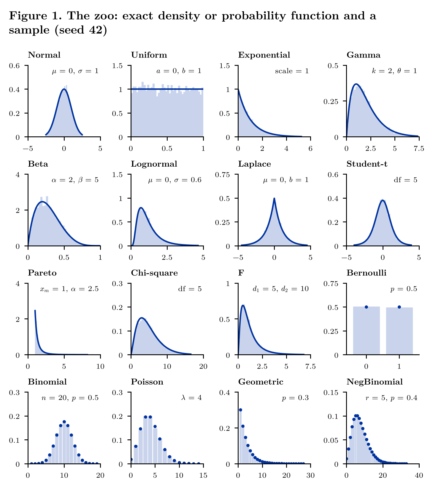
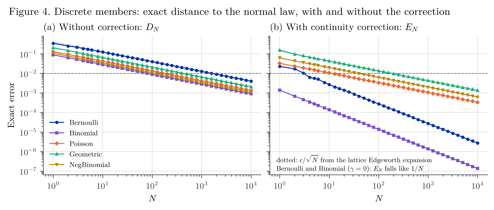

# CLT Zoo: the Law of Large Numbers and the Central Limit Theorem for Sixteen Distributions

[](https://github.com/mikbalyilmaz/CLT-Zoo-exercise/actions/workflows/tests.yml)
[](LICENSE)

Version 2 of an interactive study of sixteen distributions: Normal, Uniform, Exponential, Gamma, Beta, Lognormal,
Laplace, Student-t, Pareto, Chi-square, F, Bernoulli, Binomial, Poisson, Geometric and Negative Binomial. The notebook
has two views. The **Distribution Explorer** shows the exact density or probability function, a sample and the exact
distribution function. The **LLN and CLT view** shows a running mean, the sampling distribution of the mean for a
sample size $N$ and $M$ replications, and the standardized mean against $\mathcal N(0,1)$; the normal curves appear only
when the variance is finite. The parameters, slider ranges, presets and samplers are those of version 1, so a seed
gives the same draws. A short project note explains each analysis and writes out the mathematics behind it.



## Contents

| Path | What it is |
|---|---|
| `cltzoo/distributions.py` | The sixteen distributions: parameters, slider ranges and presets of version 1, samplers (identical to version 1), exact laws, exact moments, moment order, closed-form law of the sum of $N$ draws |
| `cltzoo/clt.py` | Running means, sample means, exact distance of the standardized mean to $\mathcal N(0,1)$ with and without the continuity correction, lattice Edgeworth constants |
| `cltzoo/panels.py`, `cltzoo/widgets.py` | The two notebook views as figure functions, and their controls |
| `cltzoo/legacy.py` | Runs the code of version 1 from `legacy/clt_zoo_v1.ipynb`, for comparison |
| `notebook/clt_zoo.ipynb` | The interactive notebook |
| `tests/run_tests.py` | Unit tests against version 1, numerical integration, convolution, goodness-of-fit tests and brute-force search |
| `analysis/01_zoo.py` | The zoo, its moments, and what the explorer of version 1 computed (Figure 1) |
| `analysis/02_lln.py` | The LLN on the Pareto slider: finite variance, infinite variance, infinite mean (Figure 2) |
| `analysis/03_clt.py` | The standardized mean across the zoo; exact distances for the discrete members (Figures 3, 4) |
| `analysis/run_all.py` | Runs the three analyses in order (about two minutes) |
| `figures/` | Figures as PNG (300 dpi) and PDF, every reported table as CSV |
| `paper/zoo_note.pdf` | Project note; `make_paper.py` writes all its numbers from `figures/*.csv` |
| `legacy/` | Version 1 (notebook and README), unchanged |
| `fonts/` | Latin Modern Roman (GUST Font License) |

## How to run

```
pip install -r requirements.txt
python tests/run_tests.py
cd analysis
python run_all.py
cd ../paper
python make_paper.py
xelatex zoo_note.tex && xelatex zoo_note.tex       # needs XeLaTeX
```

For the interactive views: `pip install jupyter`, then open `notebook/clt_zoo.ipynb` and run its cells. Seeds are
fixed, so every number is the same at every run.

## Usage

```python
import numpy as np
from cltzoo import ZOO, kolmogorov_distance, corrected_error, sample_means

d = ZOO["Poisson"]
p = d.preset_params()                       # {'lambda_': 4.0}
d.moments(**p)                              # mean, var, skew, exkurt (nan where they do not exist)
d.sum_law(30, **p)                          # exact law of X_1 + ... + X_30: Poisson(120)
kolmogorov_distance(d, p, 30)               # exact sup |P(Z_30 <= x) - Phi(x)| and where it is attained
corrected_error(d, p, 30)                   # the same with the continuity correction
sample_means(d, p, N=30, M=5000, rng=np.random.default_rng(42))
```

## Main results

- **The zoo of version 1 is correct; its explorer was not.** Its samplers and densities are reproduced exactly. Its
  distribution function was a numerical integral rescaled to end at 1 on the plotting window, with errors up to 0.022
  (Pareto); Binomial and Negative Binomial stopped with an `OverflowError` at 76 slider positions; an impossible Uniform
  range ($b \le a$) was changed silently. Version 2 has none of these.
- **The LLN on the Pareto slider.** For $\alpha = 2.5$, 1.5 and 0.8 the median error of the running mean scales like
  $n^{-0.491}$, $n^{-0.332}$ and (the mean being infinite) $n^{+0.272}$, against the theoretical $n^{-1/2}$,
  $n^{1/\alpha - 1} = n^{-1/3}$ and $n^{+1/4}$.
- **The continuity correction, measured exactly.** For the five discrete members the distance of $Z_N$ to
  $\mathcal N(0,1)$ is $c_D/\sqrt N$ and, with the continuity correction, $c_E/\sqrt N$, with the constants of the
  lattice Edgeworth expansion matched to four decimals. The correction removes the lattice term and leaves the skewness
  term: to bring the error below 0.01, Bernoulli(0.5) needs $N = 1{,}592$ without it and $N = 4$ with it; Geometric(0.3)
  needs 427 and 183.

All numbers are in `figures/*.csv` and in the project note.



## Changes from version 1

See [NEWS.md](NEWS.md): what was added and a table of the corrections to version 1.

## Citation

See [CITATION.cff](CITATION.cff), or:

> Yılmaz, M. İ. (2026). *CLT Zoo: the Law of Large Numbers and the Central Limit Theorem for sixteen distributions*
> (Version 2.0.1) [Computer software]. https://github.com/mikbalyilmaz/CLT-Zoo-exercise

## License

MIT, see [LICENSE](LICENSE).
